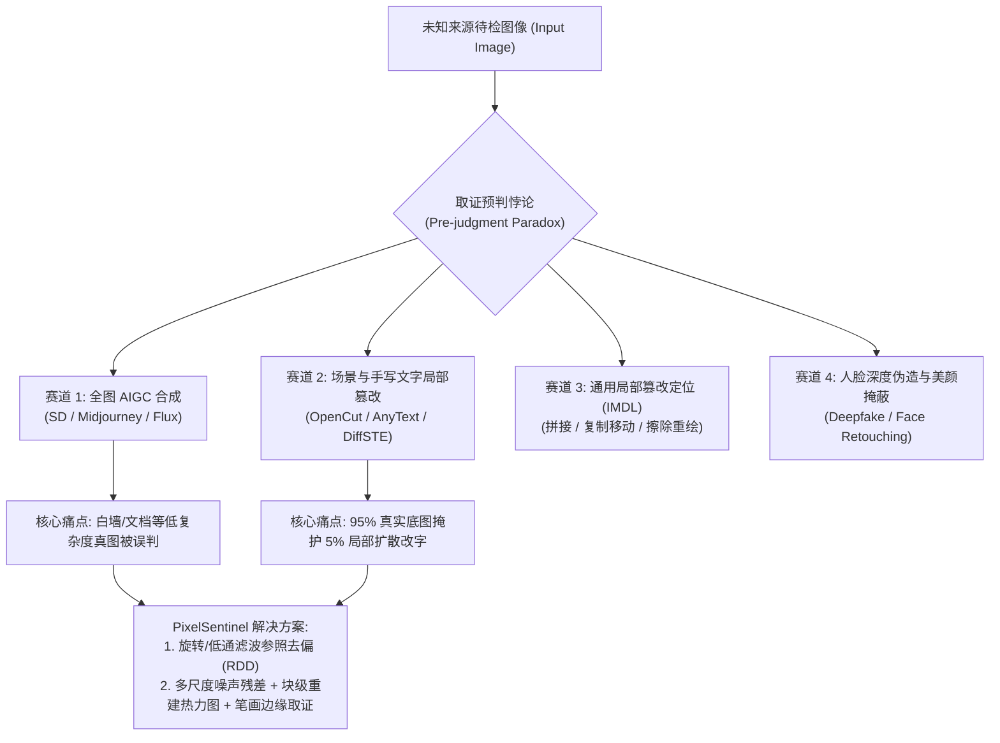

# 🛡️ PixelSentinel-Forensics

> **信息安全竞赛 · AI 图像伪造识别、局部文字篡改取证与检测器去偏研究**  
> *AI-Generated Image (AIGI) Detection, Scene/Handwritten Text Tampering Forensics & Detector Debiasing Research*

[](https://opensource.org/licenses/MIT)
[](https://www.python.org/)
[-EE4C2C.svg)](https://pytorch.org/)
[](#)

---

## 📌 一、项目背景与核心问题

随着扩散模型（Diffusion Models）与流匹配（Flow Matching）生成技术的演进，视觉内容安全面临两大极具挑战性的现实威胁：

1. **全图合成与检测器「背景复杂度偏差」（Background Complexity Bias）**  
   主流免训练/训练型 AI 图像检测器（如 AEROBLADE、DIRE、CNNSpot）依赖自编码器重建误差或频域残差判别真伪。然而在**中文手机实拍场景**（如白墙人像、纸质文档、干净天空、微信压缩图像）中，由于真实图像本身背景极其简单，自编码器重建误差天然偏低，导致**大量真实实拍照片被误判为 AI 生成图（高假阳性率 FPR）**。
2. **以 OpenCut 为代表的「AI 局部无痕改字 / 手写字篡改」（Localized AI Text & Handwriting Tampering）**  
   新一代在线 AI 视觉编辑工具（如 **OpenCut** 的 AI 图片无痕改字、阿里 **AnyText**、**DiffSTE** 等）能够在保留 95% 以上真实相机底图的前提下，仅对图像中的**手写字、收据金额、笔记、路牌或证件文字**进行局部擦除重绘与风格迁移。此类「真底图 + 局部微区域扩散重绘」直接击穿了传统全局 AIGC 检测器，形成图像取证领域的**「预判悖论」（Pre-judgment Paradox）**。

本项目面向信息安全竞赛（内容安全与安全检测赛道），构建一套**「检测器偏差体检 + 参照变换去偏 + 局部文字/手写篡改多维取证」**的研究与工具框架。

---

## 🧭 二、四大取证赛道与「预判悖论」

受 NeurIPS 2025 [ForensicHub](https://github.com/scu-zjz/ForensicHub) 统一取证基准启发，我们将 AI 视觉伪造取证划分为四个正交又相互交织的维度：



---

## 🔍 三、重点研究：如何识破 OpenCut 等 AI 手写字/文字篡改与全图伪造？

针对 **OpenCut（AI 图片无痕改字）** 等可以替换现实照片中手写字或印刷字的工具，以及主流扩散生成模型，我们总结并实现了 **5 大核心鉴别与取证方法**（详见 [`docs/opencut_and_text_tampering_forensics.md`](docs/opencut_and_text_tampering_forensics.md)）：

| 维度 | 取证方法 | 针对的造假机理 | 适用场景（全图 AIGC / OpenCut 局部改字） |
| :--- | :--- | :--- | :--- |
| **1. 高频传感器噪声残差** | **SRM 高通滤波与噪声指纹（NoisePrint / Bayar Conv）** | 真实手机拍照含全图一致的 CMOS 传感器噪声（PRNU）与 ISP 滤波痕迹；OpenCut 在文字框内用扩散/LaMa 擦除背景再重绘文字，会在文字矩形框内形成**「高频相机噪声真空区」**。 | ⭐⭐⭐⭐⭐ 极易框出 OpenCut 改字边界 |
| **2. 块级自编码器去偏重建** | **Patch-wise AEROBLADE + 参照去偏（RDD）** | 经过扩散模型重绘的文字区域已经落在 VAE 流形上，其局部 LPIPS 重建误差显著低于周围未篡改的真实手写字；结合 **90° 旋转与低通滤波参照变换**，可剔除白纸/白墙背景带来的共模偏差。 | ⭐⭐⭐⭐⭐ 兼顾全图去偏与局部扩散检测 |
| **3. 笔画微观边缘与纸张纹理** | **多尺度介观特征（Mesorch）+ 边缘感知（EAN）** | 真实手写墨迹在纸张纤维上有自然的渗透梯度与笔画压感连续性；AI 拟合的手写字在笔画边缘存在**高频频谱截断（Spectral Roll-off）**、微弱光晕（Halo）以及字下纸张纹理被平滑涂抹的断层。 | ⭐⭐⭐⭐⭐ 专攻手写体/文档金额篡改 |
| **4. 压缩双重量化与重编码** | **ELA（误差水平分析）+ 8×8 DCT 量化表核验** | 局部修图或网页端工具（OpenCut）导出时，篡改区域的 8×8 JPEG DCT 块残差与原图背景存在压缩代数差（Double JPEG Compression），且量化表从手机原生（Apple/Xiaomi）变为 Web 标准库（Skia/libjpeg）。 | ⭐⭐⭐⭐☆ 快速初筛与低成本取证 |
| **5. 频域周期性伪影分析** | **2D-FFT / DCT 高频谱异常检测** | 上采样层（Upsampling / ConvTranspose）与潜空间解码器会在频谱图高频四角或轴向留下栅格状周期性伪影。 | ⭐⭐⭐⭐☆ 全图 AIGC 生成检测 |

---

## 📂 四、仓库目录结构

```text
PixelSentinel-Forensics/
├── README.md                                                  # 项目总览与研究导航
├── requirements.txt                                           # 依赖包配置
├── docs/
│   ├── forensic_prompt_engineering_and_sota_training.md       # ⭐ 核心：让AI注意到微观破绽的专用提示词库 + 顶会低算力训练方案调研
│   ├── opencut_and_text_tampering_forensics.md                # 深度调研：OpenCut 手写字篡改机理与五维鉴别法
│   ├── detector_bias_and_rdd_debiasing.md                     # 理论与实验：AI 检测器背景复杂度偏差诊断与去偏方案
│   └── related_works_matrix.md                                # 2024–2026 顶会开源仓库对标矩阵（Benchmark & SOTA）
└── src/
    ├── forensic_prompt_pipeline.py                            # ⭐ 免训练：自动生成「视觉提示拼图 + 定量信号注入取证 Prompt」
    ├── forensics_toolkit.py                                   # 多维图像取证与去偏诊断工具（输出六合一热力图报告）
    ├── models/
    │   └── clip_forensic_classifier.py                        # 冻结CLIP-ViT + Top-K局部块异常池化 + SRM侧信道轻量级模型定义
    └── data/
        └── synthesize_tampered_data.py                        # OpenCut局部改字与AIGC配对样本合成器
```

---

## 🚀 五、快速开始（多维取证诊断工具）

`src/forensics_toolkit.py` 提供了开箱即用的多维图像取证脚本，无需重训大模型即可对任意待检图片（实拍图、AIGC 合成图、OpenCut 局部改字图）生成**六合一可视化诊断报告**：

1. **原图与元数据检查（EXIF / 量化表指纹）**
2. **ELA 重压缩误差热力图（Error Level Analysis）**
3. **SRM 高频噪声残差图（暴露局部擦除与重绘边界）**
4. **笔画/边缘梯度不一致性图（Sobel/Laplacian 边缘取证）**
5. **块级图像复杂度分布图（Background Complexity Map）**
6. **旋转+低通参照去偏异常定位图（Reference-Debiased Anomaly Map）**

### 运行方式

```bash
# 安装基础依赖
pip install numpy pillow scipy matplotlib

# 对单张可疑图片运行多维取证诊断（自动生成可视化报告与 JSON 诊断结论）
python src/forensics_toolkit.py --image path/to/suspicious_image.jpg --output report_out/
```

---

## 📚 六、参考与对标开源仓库（2024–2026）

本仓库在架构设计与方法研究上重点参考并致敬以下前沿工作（详细对比见 [`docs/related_works_matrix.md`](docs/related_works_matrix.md)）：

- **评测与统一框架**：
  - [Ekko-zn/AIGCDetectBenchmark](https://github.com/Ekko-zn/AIGCDetectBenchmark) — 统一集成 CNNSpot、UnivFD、DIRE、LGrad 等 8 种检测器的评测基准
  - [scu-zjz/ForensicHub](https://github.com/scu-zjz/ForensicHub) *(NeurIPS 2025)* — 覆盖 AIGC、IMDL、文档篡改、Deepfake 四赛道的统一取证框架
  - [shilinyan99/AIDE](https://github.com/shilinyan99/AIDE) *(ICLR 2025)* — *A Sanity Check for AI-generated Image Detection*
- **免训练重建与去偏**：
  - [jonasricker/aeroblade](https://github.com/jonasricker/aeroblade) *(CVPR 2024)* — 基于扩散模型自编码器 LPIPS 重建距离的免训练检测
  - *RDD (CVPR 2026)* — *A Debiased Reconstruction-based Framework*（参照变换去偏核心思想来源）
- **文本/手写篡改与局部取证定位**：
  - [scu-zjz/Mesorch](https://github.com/scu-zjz/Mesorch) *(AAAI 2025)* — 多尺度介观架构，在文本篡改与通用篡改定位上表现优异
  - [MrHuan3/MUN](https://github.com/MrHuan3/MUN) *(AAAI 2025)* — 噪声指纹（NoisePrint）+ 双向解码图像篡改定位
  - [Kamichanw/Loupe](https://github.com/Kamichanw/Loupe) *(IJCAI 2025)* — DDL 挑战赛冠军轻量化篡改检测方案
  - *TextSleuth (MIPR 2024)* & *FFDN (ECCV 2024)* — 面向场景文字编辑（Scene Text Editing）与数字文档篡改的可解释检测

---

## 📄 License

本项目遵循 [MIT License](LICENSE) 开源协议，仅用于信息安全竞赛防御性技术研究与学术交流。
