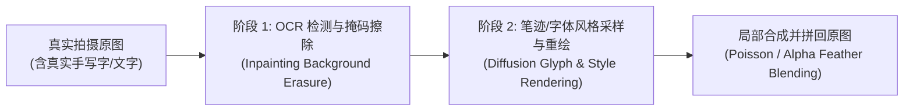

# OpenCut 等 AI 场景文字/手写字替换机理与五维鉴别方法

> **研究专题**：局部 AI 文字篡改（Scene Text Editing & Handwritten Text Tampering）的生成机理与被动取证方案  
> **典型攻击工具对标**：[OpenCut (AI 图片无痕改字)](https://opencut.net/)、AnyText / AnyText2 (Alibaba)、DiffSTE、TextDiffuser、Flux-Fill

---

## 一、为什么以 OpenCut 为代表的「AI 换字」比全图 AI 生成更难检测？

传统的图像篡改（如用 Photoshop 仿制图章或直接打字覆盖）容易留下生硬的矩形边缘、字体透视不一致或纯色涂抹块。而像 **OpenCut** 这类新一代「AI 图片无痕改字」网站，允许用户直接上传一张**现实中拍摄的真实照片（含手写笔记、白板签名、收据单据、路牌、包装盒）**，框选其中的手写字或印刷字并输入新文字，在数秒内即可完成「同笔迹/同风格」替换。

### 1. OpenCut 等 AI 改字工具的双阶段流水线（Two-Stage Pipeline）

1. **阶段 1：智能擦除与背景纹理修补（Background Inpainting）**  
   系统首先通过 OCR 识别原文字的笔画掩码（Mask），随后调用图像修补模型（如 LaMa 或 Latent Diffusion Inpainting）抹除原有字迹，并根据周围纸张纤维、桌面木纹或墙面光影自动合成出「无字背景」。
2. **阶段 2：笔迹风格迁移与字形扩散渲染（Style-Guided Glyph Diffusion）**  
   类似 **AnyText**（OCR 辅助潜空间扩散）或 **DiffSTE**（双编码器：字符编码器控制字形可读性 + 风格编码器采样原图墨色、笔画粗细、倾斜角、光影透视），模型将用户输入的新文字渲染成与原手写体高度近似的像素，并通过羽化掩码（Feathering Mask）无缝融合回原图。

### 2. 对传统 AI 检测器的致命挑战

- **全局特征被稀释（Dilution Effect）**：一张照片中可能 **95% 以上的像素都是真实的手机实拍像素**，只有 **2%–5% 的文字框区域**经过了 AI 重绘。把整张图丢给全局 AIGC 检测器（如 CNNSpot、UnivFD、全局 AEROBLADE），全局平均池化（GAP）会直接淹没微小的局部伪影，导致**漏报（False Negative）**。
- **纸张/白墙引发的反向误判（Background Complexity Bias）**：如果待检图片是一张白纸上的手写收据或白板照片，未篡改的原图反而因为大面积纯白低复杂度背景被全局检测器误判为 AI 图（**误报 False Positive**）。

---

## 二、识别 OpenCut 与 AI 造假图片的五大核心取证方法

针对上述「真底图 + 局部 AI 换字」以及「全图 AIGC 合成」两类造假，我们从**传感器物理层、压缩编码层、像素微结构层、扩散流形层、多模态语义层**提炼出五种可落地的鉴别方法：

---

### 方法 1：SRM 高频噪声残差与相机传感器指纹（专克局部擦除重绘）

#### 原理
真实手机摄像头成像时，经过 CMOS 感光元件（PRNU 光响应非均匀性）与 ISP（图像信号处理器）的去马赛克（Demosaicing）、锐化滤波，会在全图高频部分留下一层肉眼不可见但统计特性高度均匀的**背景噪声残差（Noise Residual）**。

当 OpenCut 对文字框区域进行「擦除 + 扩散重绘」时：
- 扩散模型的 VAE 解码器（Decoder）生成的像素高频分量与原手机 ISP 的噪声分布完全不同；
- 即使视觉上纸张颜色、纹理完全对齐，只要用 **SRM（Spatial Rich Model）高通滤波器组**提取残差：
  $$R(x, y) = \sum_{k} \left| I * K_{\text{SRM}}^{(k)} \right|$$
  就会在被替换的手写字矩形框处看到一个明显的**「噪声孤岛 / 噪声断层」（Noise Discontinuity Box）**。

#### 鉴别特征
- **真实手写原图**：字迹与周围纸张的高频噪声基底连续过渡，无矩形框边界。
- **OpenCut 改字图**：被替换文字周围出现矩形或胶囊状的噪声方差突变区（方差通常显著偏低或呈现扩散模型特有的高频网格）。

---

### 方法 2：块级自编码器去偏重建热力图（Patch-wise Debiased AEROBLADE）

#### 原理
CVPR 2024 的 **AEROBLADE** 发现：扩散模型生成的图像已经位于潜空间自编码器（VAE）的流形上，因此再次通过 VAE 重建时的 LPIPS 距离 $\Delta_{\text{AE}}(x) = d_{\text{LPIPS}}(x, D(E(x)))$ 极小。  
而 CVPR 2026 的 **RDD（Reference-guided Debiasing）** 进一步指出：必须扣除「图像自身复杂度」带来的偏差。

我们将这一思想从**全图打分**升级为**滑动窗口/块级热力图（Patch-wise Debiased Map）**：
1. 对原图 $x$、90° 旋转图 $R_{90}(x)$、低通滤波图 $F_{\text{LP}}(x)$ 分别计算像素级/块级重建误差映射；
2. 计算去偏后的局部重建异常度：
   $$S_{\text{local}}(i, j) = \Delta_{\text{AE}}(x)_{i,j} - \alpha \Delta_{\text{AE}}(R_{90}(x))_{i,j} - \beta \Delta_{\text{AE}}(F_{\text{LP}}(x))_{i,j}$$
3. **在同一页手写笔记上做同行对比（Intra-Document Calibration）**：
   同一张图里既有「真手写字」又有「OpenCut 替换的手写字」。真手写字从未进过 VAE，重建误差大；而被 OpenCut 替换的那几个字刚刚从 VAE 解码出来，其块级去偏重建误差会显著低于同行其他真字！

---

### 方法 3：手写笔画边缘微观物理取证（Stroke Edge & Ink-Paper Interaction）

#### 原理
AI 可以模仿一个人的字形轮廓（连笔、倾斜度、粗细），但极难在微观像素级还原真实的**物理墨水与纸张交互**：

1. **墨迹渗透与边缘梯度（Ink Bleed & Gradient Profile）**：
   - **真手写字**：中性笔、钢笔或马克笔划过纸面时，墨水沿纸张纤维毛细管扩散，笔画边缘法向梯度呈现非对称的微锯齿状（与纸张纹理方向耦合），且起笔、顿笔、收笔处存在真实的色彩饱和度深浅变化（墨水堆积效应）。
   - **OpenCut / AnyText 伪造字**：扩散模型生成的笔画边缘往往经过潜空间上采样平滑，表现为**过于均匀的抗锯齿羽化（Anti-aliasing Halo）**，且笔画交叉处（两笔重叠点）缺乏双倍墨水深度的物理叠加，往往是均匀的单色色块。
2. **字下纸张纹理连续性（Sub-Stroke Texture Continuity）**：
   - 在真实照片中，横格线、纸张褶皱或阴影会自然穿过手写笔画并与墨水发生乘性混合（Multiply Blending）。
   - AI 改字在擦除原字时往往将横格线一并重绘，导致新字下方的横格线出现微小的**错位、弯曲或模糊断裂**。

---

### 方法 4：ELA（误差水平分析）与 JPEG 双重压缩量化表取证

#### 原理
1. **元数据与量化表指纹（EXIF & DQT Forensics）**：
   - 手机原生直出照片包含完整的传感器 EXIF（快门、ISO、镜头焦距）以及厂商私有的 JPEG 量化表（DQT）。
   - 经过 OpenCut 等网页端处理并下载后，EXIF 被清空，色彩空间被统一转换为标准 sRGB，且使用 Web 后端编码器（如 `libjpeg-turbo` 或浏览器 Canvas 导出）重新量化。
2. **局部重压缩残差（Error Level Analysis）**：
   - 将待检图以固定质量（如 $Q=90$）二次保存为 JPEG，计算像素绝对差：
     $$\text{ELA}(x) = |x - \text{JPEG}_{Q=90}(x)| \times \gamma$$
   - 若攻击者将 AI 生成的局部文字块贴回原 JPEG 图像，修改区域的 8×8 DCT 块网格与原图未修改区域处于不同的压缩收敛阶段，在 ELA 热力图上会呈现出明显的亮度差异。

---

### 方法 5：多尺度介观特征与跨赛道协同检测（Mesorch + EAN 路线）

针对竞赛进阶阶段，可结合顶会开源模型对局部文字篡改进行像素级分割（Mask Localization）：

- **Mesorch（AAAI 2025，[`scu-zjz/Mesorch`](https://github.com/scu-zjz/Mesorch)）**：专为包含文本篡改在内的图像伪造定位设计，结合 CNN（捕获局部高频伪影）与 Transformer（捕获全局光照/上下文一致性）的多尺度介观（Mesoscopic）架构，能够直接输出篡改文字的二值掩码（Binary Mask）。
- **EAN（TCSVT 2025）**：利用边缘感知模块（Edge-Aware Module, EAM）专门放大篡改区域与原始背景交界处的边缘残差，对「框选改字」留下的拼贴边界极其敏感。

---

## 三、实验设计建议：如何在竞赛作品中展示 OpenCut 取证？

为了在竞赛答辩和报告中做出让人眼前一亮的实验，建议构建一个**「手写与场景文字微篡改测试集（Mini-Benchmark）」**：

1. **样本采集（20–50 组配对样本）**：
   - 用手机实拍手写实验记录、手写假条、白板公式、快递单/收据、校园路牌；
   - 使用 **OpenCut（AI 图片无痕改字）** 修改其中的关键数字、签名或单词，保存生成图，形成 `(原图, OpenCut 篡改图, 篡改区域真值框)` 三元组。
2. **揭示「预判悖论」对比实验**：
   - 展示传统全局 AIGC 检测器在「原图 vs OpenCut 篡改图」上的得分几乎没有区分度（因为 95% 像素相同）；
   - 展示使用本仓库的 **SRM 噪声残差 + 块级参照去偏热力图 + 笔画边缘分析** 后，能够精准高亮出被 OpenCut 替换的那几个手写字！
